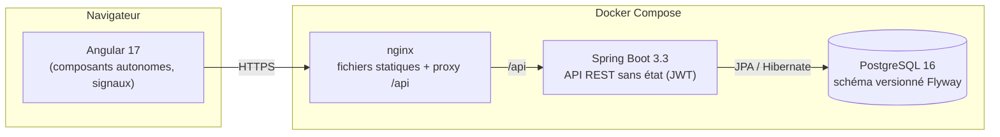
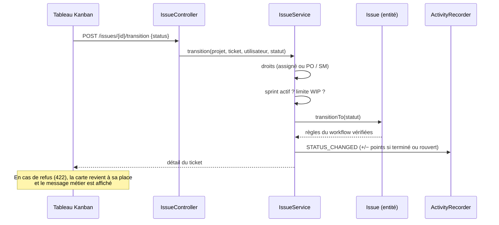

# Architecture

## Vue d'ensemble



## Back-end : organisation par fonctionnalité

```
com.mckevin.sprintmanager
├── user        Comptes, inscription, connexion, émission des jetons JWT
├── project     Projets, équipe, rôles Scrum, contrôle d'accès (ProjectAccess)
├── issue       Tickets, workflow (IssueWorkflow), estimation, commentaires
├── sprint      Cycle de vie des sprints, tableau Kanban
├── activity    Journal d'activité en ajout seul
├── report      Burndown (BurndownCalculator), vélocité, vue d'ensemble
├── demo        Données de démonstration
├── config      Sécurité, OpenAPI, horloge
└── shared      Exceptions métier, erreurs RFC 7807, pagination
```

Chaque paquet contient son entité, son dépôt, son service, son contrôleur et ses DTO. Les dépendances vont des fonctionnalités de haut niveau (rapports) vers celles de bas niveau (tickets, sprints), jamais l'inverse.

### Où vivent les règles métier

| Règle | Emplacement | Test |
|---|---|---|
| Transitions autorisées (revue obligatoire) | `IssueWorkflow` | `IssueWorkflowTest` |
| Story estimée avant d'être terminée, points Fibonacci | `Issue`, `StoryPoints` | `IssueTest` |
| Objectif, dates, durée maximale d'un sprint | `Sprint` | `SprintTest` |
| Un seul sprint actif, stories estimées au démarrage | `SprintService` + index unique partiel en base | `SprintLifecycleIT` |
| Limite de travail en cours (WIP) par personne | `IssueService.transition` | `SprintLifecycleIT` |
| Droits par rôle | `ProjectAccess` + services | `ProjectTeamIT`, `SprintLifecycleIT` |
| Toujours au moins un Product Owner | `ProjectService` | `ProjectTeamIT` |
| Calcul du burndown | `BurndownCalculator` (fonction pure) | `BurndownCalculatorTest` |

## Le journal d'activité, source du burndown

Chaque action écrit un `ActivityEvent`. Quand elle modifie le travail restant du sprint actif, l'événement porte un `remainingDelta` :

| Événement | Effet sur le travail restant |
|---|---|
| Démarrage du sprint | Engagement initial, figé dans `Sprint.committedPoints` |
| Ticket ajouté au sprint actif | + points |
| Ticket retiré du sprint actif | − points |
| Ticket terminé | − points |
| Ticket rouvert | + points |
| Réestimation d'un ticket non terminé | ± écart |

Le burndown d'un jour J vaut l'engagement plus la somme des variations survenues jusqu'à la fin de J (fuseau Europe/Paris). Ce choix donne un historique fidèle, y compris en cas d'ajout de périmètre en cours de sprint, sans table d'instantanés quotidiens à alimenter par une tâche planifiée.

## Séquence : faire avancer un ticket



## Sécurité

- Authentification par jeton JWT signé HS256 (`spring-boot-starter-oauth2-resource-server`), durée de validité configurable.
- API sans session ni cookie : pas d'exposition au CSRF.
- Mots de passe hachés avec BCrypt.
- Un non-membre reçoit 404 sur un projet (son existence n'est pas révélée), un membre sans le bon rôle reçoit 403.
- Le secret JWT, les identifiants de base et les origines CORS viennent de variables d'environnement.

## Front-end

```
src/app
├── core       Modèles, client API typé, authentification, intercepteur, thème, contexte du projet
├── shared     Composants d'affichage réutilisables (avatar, icônes, graphique, état vide)
└── features   Une page par dossier : auth, projects, shell, overview, board, backlog, reports, team, activity, issue
```

- Routage paresseux : chaque page est chargée à la demande.
- État local en signaux ; `ProjectContext.revision` prévient les pages ouvertes qu'une donnée a changé.
- Déplacements optimistes sur le tableau, annulés si l'API refuse la transition.
- Thème clair et sombre par variables CSS, appliqué aussi aux graphiques Chart.js.
